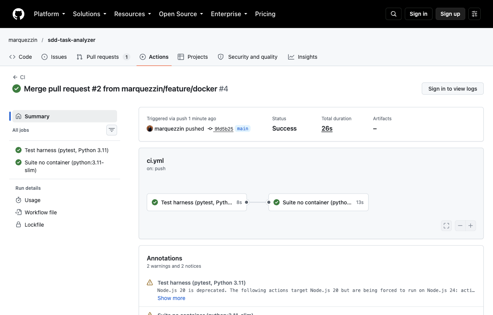

# Relatório Técnico de Governança e Ética de IA

- **Projeto:** TaskAnalyzer (sdd-task-analyzer)
- **Disciplina:** Bootcamp III, CEUB EAD. Desafio Final (Fase 3, 25,0 pontos)
- **Autor:** Gabriel Marques da Rocha, Ciência da Computação, Turma A - 0726
- **Repositório:** https://github.com/marquezzin/sdd-task-analyzer
- **Vídeo (pitch técnico):** a publicar (link na entrega do AVA)

## 1. Contexto e escopo desta fase

O TaskAnalyzer é um módulo Python de métricas de produtividade (tempo médio de conclusão e taxa de atraso, gerais e por prioridade). O projeto é cumulativo:

| Fase | Entrega | Onde está |
|---|---|---|
| 1 | Especificação SDD (contrato executável), cenários de aceite e CONTEXT_RULES | `specs/system_design_document.pdf`, `specs/task_analyzer_spec.md`, `CONTEXT_RULES.md` |
| 2 | Código gerado por IA, test harness (19 testes) e versionamento com PRs | `src/task_analyzer.py`, `tests/test_harness.py`; publicado originalmente em [giovanniacg/sdd-task-analyzer](https://github.com/giovanniacg/sdd-task-analyzer) |
| 3 | CI/CD, containerização, este relatório e o pitch técnico | `.github/workflows/ci.yml`, `Dockerfile`, `docker-compose.yml`, `docs/`, `specs/requirements.yaml` |

Para a Fase 3 o histórico completo de commits da Fase 2 foi migrado para a conta do autor (`marquezzin/sdd-task-analyzer`), preservando os commits originais (autoria, mensagens e merges) e as branches de funcionalidade. Pull requests não migram com o histórico git: os da Fase 2 continuam no repositório original ([PR #1, test harness](https://github.com/giovanniacg/sdd-task-analyzer/pull/1) e [PR #2, implementação](https://github.com/giovanniacg/sdd-task-analyzer/pull/2)). Os PRs #1 a #4 citados daqui em diante são do repositório `marquezzin`, um por branch de funcionalidade, cada um com checklist de homologação:

| PR | Branch | Conteúdo |
|---|---|---|
| #1 | `feature/ci-cd` | pipeline GitHub Actions e badge no README |
| #2 | `feature/docker` | Dockerfile, docker-compose.yml, job `docker` no CI |
| #3 | `feature/governance-docs` | SDD em PDF, `requirements.yaml`, este relatório, registro de prompts |
| #4 | `feature/ci-actions-node24` | atualização de `actions/checkout` e `actions/setup-python` para versões com Node.js 24, após avisos de descontinuação no primeiro run da `main` |

Assistentes de IA: na Fase 2, Claude (Anthropic) via assistente de código (modelo Claude Sonnet 5.5, conforme a linha `Co-Authored-By` dos commits); na Fase 3, Claude Code (Anthropic) com o modelo Claude Fable 5.1. Em ambas, o contexto fornecido antes de qualquer geração foi `CONTEXT_RULES.md` + `specs/task_analyzer_spec.md`, e cada saída passou por revisão humana antes de entrar no repositório.

## 2. Pilar 1: integração contínua (GitHub Actions)

Arquivo: `.github/workflows/ci.yml`.

- **Gatilhos:** `push` e `pull_request` nas branches `main` e `develop`.
- **Ambiente:** `ubuntu-latest` com Python **3.11**, a versão mínima exigida pelo CONTEXT_RULES 1.1. A máquina de desenvolvimento roda Python 3.14; o pipeline fixa 3.11 de propósito, porque o que precisa ficar provado é o mínimo do contrato, independente da máquina do autor.
- **Preparação:** atualiza o `pip` e instala só o `requirements.txt`, que contém apenas `pytest`. Nenhuma ferramenta extra (linter, cobertura) entrou no pipeline: a restrição de dependências do CONTEXT_RULES 2.1 vale para o módulo, e o autor decidiu estendê-la ao CI.
- **Execução:** `pytest tests/test_harness.py -v`. Qualquer teste falhando derruba o build e bloqueia o merge: a branch `main` tem proteção que exige os checks `test` e `docker` aprovados.
- **Segundo job (`docker`):** depende do primeiro, constrói a imagem com `docker compose build` e executa a suíte dentro do container com `docker compose run --rm tests`. O pipeline valida o código e o empacotamento.
- **Permissões:** o workflow declara `permissions: contents: read`, o mínimo necessário para fazer checkout.

Evidência: execução do pipeline na branch `main`, jobs `test` e `docker` aprovados.



## 3. Pilar 2: containerização (Docker e Docker Compose)

**Dockerfile** (empacotamento):

- base `python:3.11-slim`, leve, na mesma versão mínima do contrato;
- `requirements.txt` copiado e instalado antes do código, para aproveitar o cache de camadas;
- só `requirements.txt`, `src/` e `tests/` entram na imagem (o `.dockerignore` exclui `.git`, documentação, caches e ambientes virtuais);
- a suíte roda como usuário sem privilégios (`analyzer`), não como root;
- `CMD ["pytest", "tests/test_harness.py", "-v"]` como comando de entrada.

**docker-compose.yml** (orquestração): define o serviço `tests`, apontando para o Dockerfile, com a mesma linha de comando. A suíte inteira roda com um único comando, em qualquer máquina com Docker:

```bash
docker compose run --rm tests
```

Evidência: execução local na imagem construída (Python 3.11.17 dentro do container, 231 MB de imagem):

```text
============================= test session starts ==============================
platform linux -- Python 3.11.17, pytest-9.1.1, pluggy-1.7.0 -- /usr/local/bin/python3.11
cachedir: .pytest_cache
rootdir: /app
collecting ... collected 19 items

tests/test_harness.py::test_metricas_gerais_com_tarefas_validas PASSED   [  5%]
tests/test_harness.py::test_indicadores_por_prioridade PASSED            [ 10%]
tests/test_harness.py::test_ignora_tarefas_nao_concluidas PASSED         [ 15%]
tests/test_harness.py::test_arredonda_com_duas_casas_decimais PASSED     [ 21%]
tests/test_harness.py::test_prioridade_sem_tarefas_concluidas_retorna_zeros PASSED [ 26%]
tests/test_harness.py::test_nao_altera_a_lista_de_entrada PASSED         [ 31%]
tests/test_harness.py::test_excecao_data_conclusao_antes_do_inicio PASSED [ 36%]
tests/test_harness.py::test_excecao_concluida_sem_datas_de_execucao PASSED [ 42%]
tests/test_harness.py::test_excecao_sem_tarefas_concluidas PASSED        [ 47%]
tests/test_harness.py::test_excecao_lista_vazia PASSED                   [ 52%]
tests/test_harness.py::test_excecao_valor_fora_do_contrato[prioridade-urgente] PASSED [ 57%]
tests/test_harness.py::test_excecao_valor_fora_do_contrato[status-arquivada] PASSED [ 63%]
tests/test_harness.py::test_excecao_valor_fora_do_contrato[titulo-  ] PASSED [ 68%]
tests/test_harness.py::test_excecao_campo_obrigatorio_ausente PASSED     [ 73%]
tests/test_harness.py::test_excecao_id_repetido PASSED                   [ 78%]
tests/test_harness.py::test_excecao_id_invalido[0] PASSED                [ 84%]
tests/test_harness.py::test_excecao_id_invalido[-1] PASSED               [ 89%]
tests/test_harness.py::test_excecao_id_invalido[1] PASSED                [ 94%]
tests/test_harness.py::test_excecao_id_invalido[True] PASSED             [100%]

============================== 19 passed in 0.01s ==============================
```

O mesmo resultado da execução local da Fase 2 (19 aprovados), reproduzido em ambiente isolado. O ambiente de teste passa a ser um artefato versionado junto com o código: quem tiver Docker reproduz a suíte sem configurar nada na própria máquina.

## 4. Pilar 3: governança e ética de IA

Os três blocos pedidos no enunciado: 4.1 análise de alucinações, 4.2 homologação humana, 4.3 sustentabilidade e ética.

### 4.1 Análise de alucinações: o que o contrato barrou e o que a revisão conferiu

"Alucinação", aqui, é saída da IA que inventa comportamento, dependência ou nome fora do contrato de negócio. A tabela separa o que de fato ocorreu do que foi apenas risco conferido: o código final prova conformidade, não prova tentativa de desvio. Onde houve ocorrência, ela está registrada em prompt, PR ou commit.

| # | Ponto de risco | Regra aplicável | Ocorrência | O que ficou no código |
|---|---|---|---|---|
| 1 | Importar `pandas`, `python-dateutil` ou similares para datas e agregações | CONTEXT_RULES 2.1 (só biblioteca padrão; `pytest` apenas no harness) | Risco conferido no código final; sem ocorrência registrada. | `src/task_analyzer.py` importa somente `logging`, `datetime` e `typing`. `requirements.txt` contém só `pytest`. |
| 2 | Adotar os nomes genéricos do enunciado (`analyze_tasks`, `TaskValidationError`, tempos em horas) | Spec 1.3.1 a 1.3.3 (assinatura, campo `tempo_medio_conclusao_min`, `TarefaInvalidaError` na regra 4); CONTEXT_RULES 1.8 e 2.5 | Ocorreu como conflito de fontes: o enunciado da Fase 2 e os slides da Fase 3 usam os nomes genéricos. Decisão registrada no relatório da Fase 2 (decisão 4). | `analisar_tarefas(tarefas: list[dict]) -> dict`, `TarefaInvalidaError`, `tempo_medio_conclusao_min`. A spec da Fase 1 é a fonte da verdade. |
| 3 | Lista vazia ou só tarefas pendentes "retornar 0.0", como pede o enunciado da Fase 2 | Spec, regra 5 (denominador zero dispara `MetricasIndisponiveisError`); CONTEXT_RULES 2.8 | Ocorreu: a IA marcou o conflito na reformulação do contrato (prompt 2.1). Decisão registrada no [PR #2 da Fase 2](https://github.com/giovanniacg/sdd-task-analyzer/pull/2) (decisão 3). | `test_excecao_lista_vazia` e `test_excecao_sem_tarefas_concluidas` exigem a exceção. |
| 4 | Prioridade sem nenhuma tarefa concluída: a spec não define o valor | Spec, regra 9 (dúvida volta para o arquiteto da especificação, papel do próprio autor pela spec 1.2); CONTEXT_RULES 2.8 | Ocorreu: a IA marcou como não especificado (prompt 2.1). Decisão registrada no PR #2 da Fase 2 (decisão 1). | O grupo retorna `0.0`, `0.0` e `0`. O `quantidade_tarefas = 0` sinaliza que o `0.0` não é medição; uma exceção derrubaria a análise inteira por um grupo vazio. Coberto por `test_prioridade_sem_tarefas_concluidas_retorna_zeros`. |
| 5 | Valores fora do contrato de entrada (prioridade `urgente`, status `arquivada`, título vazio, id repetido ou não positivo): a spec descreve a tabela de entradas, mas não diz o que fazer com a violação | Spec 1.3.1 (tabela de entradas) e regra 9; CONTEXT_RULES 2.8 | Ocorreu: a IA marcou como não especificado (prompt 2.1). Decisão registrada no PR #2 da Fase 2 (decisão 2). | `TarefaInvalidaError` com o id da tarefa. Coberto por `test_excecao_valor_fora_do_contrato`, `test_excecao_campo_obrigatorio_ausente`, `test_excecao_id_repetido` e `test_excecao_id_invalido`. |
| 6 | Validar `id_tarefa` com `isinstance(id, int)`, que aceita `True` como inteiro válido em Python | Spec 1.3.1 (inteiro > 0), traduzida no harness em `test_excecao_id_invalido[True]` | Risco conferido; sem ocorrência registrada. | A implementação rejeita `bool` antes de testar `int` (`src/task_analyzer.py`, linha 61). O harness trava esse caso mesmo que ele passe despercebido na leitura. |
| 7 | Descartar em silêncio tarefa com data inconsistente e seguir calculando | Spec, regra 4 e nota de decisão (falhar explicitamente) | Risco conferido; sem ocorrência registrada. | `TarefaInvalidaError` com o id da tarefa na mensagem; `test_excecao_data_conclusao_antes_do_inicio` exige o id. |
| 8 | No CI, instalar linters e ferramentas de cobertura fora do `requirements.txt`, como fazem os templates comuns de pipeline | CONTEXT_RULES 2.1, estendida ao pipeline por decisão do autor | Risco conferido na revisão; sem ocorrência registrada. | O pipeline instala só o que está em `requirements.txt` e roda só o harness. |
| 9 | No Dockerfile, `COPY . .` e execução como root, padrão dos exemplos genéricos | Critério de revisão do autor (superfície mínima); não há regra correspondente no contrato | Risco conferido na revisão; a saída da IA já veio com cópia seletiva e usuário sem privilégios. | Só `requirements.txt`, `src/` e `tests/` entram na imagem; usuário `analyzer`. |
| 10 | Documentação: o rascunho deste relatório, gerado por IA, afirmava que `src/task_analyzer.py` tem 10 funções | CONTEXT_RULES 3.4 (revisar criticamente toda saída) | Ocorreu na Fase 3: a conferência contra o código (contagem das definições) corrigiu para 8 antes da revisão do autor. | Relatório corrigido. Texto gerado por IA alucina tanto quanto código e pede a mesma conferência contra a fonte. |

Três mecanismos aparecem na tabela. A reformulação exigida pela CONTEXT_RULES 3.2 expôs os pontos em aberto antes do código (itens 3, 4 e 5): a IA marcou dúvida em vez de inventar comportamento. O harness e a revisão conferiram no código final os riscos conhecidos (itens 1, 6 e 7). Na infraestrutura e na documentação, onde não há teste automatizado, a revisão aplicou critério de superfície mínima e conferência contra a fonte (itens 8, 9 e 10).

### 4.2 Homologação humana (Critical-in-the-Loop)

O fluxo adotado nas Fases 2 e 3 segue quatro etapas, nessa ordem:

1. **Geração.** A IA recebe `CONTEXT_RULES.md` + spec e, antes de gerar código, reformula o que vai fazer (CONTEXT_RULES 3.2). Só depois produz o artefato.
2. **Leitura crítica e barreira SDD.** O autor lê a saída antes de rodar o harness (CONTEXT_RULES 3.4); em seguida o harness roda. Na Fase 2 ele foi escrito antes da implementação e falhou de propósito (`ModuleNotFoundError`) até o módulo existir. Na Fase 3 a barreira ganhou duas camadas: o pipeline de CI em Python 3.11 e a suíte dentro do container.
3. **Homologação.** Com 100% do harness verde (spec 2.2), o autor confere o diff contra um checklist derivado das CONTEXT_RULES e registra o resultado no PR. O humano atua como filtro primário e homologador crítico.
4. **Integração.** Merge só via pull request e só com os dois checks aprovados, exigidos pela proteção da branch `main` (configurada após o primeiro run verde, antes do merge deste relatório).

Checklist aplicado ao código ([PR #2 da Fase 2](https://github.com/giovanniacg/sdd-task-analyzer/pull/2)):

- [x] Python 3.11+ e type hints em todas as funções
- [x] Apenas biblioteca padrão; sem persistência em arquivo ou banco
- [x] Assinatura pública `analisar_tarefas(tarefas: list[dict]) -> dict` inalterada
- [x] Exceções específicas com o id da tarefa na mensagem; nenhum `except Exception`
- [x] Docstrings Google style e `logging` (sem `print`)
- [x] Funções pequenas e coesas (SRP)

Checklist aplicado à infraestrutura (PRs #1 a #4 desta fase):

- [x] Pipeline atualiza o `pip` e instala só o que está em `requirements.txt`
- [x] Versão de Python fixada em 3.11 no CI e na imagem (mínimo do contrato)
- [x] Comando do CI idêntico ao comando do container e ao comando documentado no README
- [x] Imagem base `slim`; só `requirements.txt`, `src/` e `tests/` copiados; usuário sem privilégios
- [x] `permissions: contents: read` no workflow
- [x] Build e execução validados localmente antes do push (19 aprovados no container)
- [x] Nenhuma alteração em `src/`, `tests/`, `specs/task_analyzer_spec.md` ou `CONTEXT_RULES.md`; estrutura original de pastas preservada, e as pastas novas (`.github/`, `docs/`) são as exigidas pelo enunciado da Fase 3 (CONTEXT_RULES 2.2 e 2.3)

Na Fase 3 a documentação passou por uma camada extra antes da leitura do autor: um segundo agente de IA fez revisão adversarial do relatório e do registro de prompts (prompt 3.6) e apontou, entre outros, regra citada com número errado, narrativa que sugeria correção humana onde não houve e ordem inconsistente das etapas deste fluxo. As correções estão neste texto. O aceite final é do autor, que lê o relatório e marca o checklist.

O que o revisor humano fez que a automação não faria: decidiu os casos não especificados (itens 4 e 5 da tabela), manteve os nomes da spec contra o enunciado (item 2) e conferiu a superfície da imagem e do pipeline (itens 8 e 9), onde não há teste automatizado. Essas decisões estão escritas no PR #2 da Fase 2 e nos PRs desta fase, com a regra que as motivou.

### 4.3 Sustentabilidade, rastreabilidade e ética

**Rastreabilidade de prompts.** Cada entrega gerada com apoio de IA está resumida em `docs/prompts-log.md`, por pedido, com data, contexto fornecido, resultado e veredito da homologação (texto parafraseado, não transcrição literal). Os commits gerados com apoio de IA levam a linha `Co-Authored-By` identificando o modelo (Claude Sonnet 5.5 nos commits da Fase 2; Claude Fable 5.1 nos da Fase 3). As descrições do PR de implementação da Fase 2 e dos três PRs desta fase seguem o formato "o que muda / evidência / homologação contra as CONTEXT_RULES / decisões em aberto".

**Conformidade do código final gerado por IA.** Verificação feita sobre `src/task_analyzer.py` na versão mergeada:

| Regra (CONTEXT_RULES) | Como foi verificado | Resultado |
|---|---|---|
| 1.1 Python 3.11+ | CI e imagem executam a suíte em 3.11 (19 aprovados) | conforme |
| 1.2 Type hints em todas as funções | leitura das 8 funções do módulo | conforme (todas anotadas, incluindo retorno) |
| 1.4 Docstrings Google style | leitura | conforme (módulo, classes e funções) |
| 1.6 Exceções específicas, sem `except Exception` | busca textual | 0 ocorrências de `except Exception` |
| 1.7 `logging`, nunca `print` | busca textual | 0 ocorrências de `print(`; logger de módulo em uso |
| 2.1 Só biblioteca padrão | lista de imports | `logging`, `datetime`, `typing` |
| 2.4 Sem persistência | leitura | nenhum acesso a arquivo, rede ou banco |
| 2.5 Assinatura inalterada | comparação com a spec 1.3.1 | idêntica |
| Spec, regra 7 (2 casas decimais) | `test_arredonda_com_duas_casas_decimais` | aprovado |
| Spec, regra 8 (sem efeitos colaterais) | `test_nao_altera_a_lista_de_entrada` | aprovado |

A tabela cobre `src/`. O harness, também gerado por IA, fica fora dela e tem limites próprios (ver abaixo).

**Ética e dados.** Os dados de teste são fictícios e gerados no próprio harness. Não há dado pessoal além da identificação do próprio autor (nome e e-mail institucional na spec, e-mail nos commits), nem credencial ou segredo no repositório. O módulo não persiste nem transmite nada (regra 8). Sobre o produto: o TaskAnalyzer mede fluxo de tarefas, não pessoas. A entrada não tem campo de responsável, e usá-lo para avaliação individual exigiria outro contrato e outra discussão ética. O uso de IA está declarado no README, nos commits e neste relatório: a IA gerou, o autor homologou e responde pelo resultado. Nenhum código gerado por IA entrou sem passar pelo harness; nenhum artefato (código, configuração ou texto) entrou sem revisão do autor.

**Sustentabilidade computacional.** A imagem parte de `python:3.11-slim` (231 MB construída; a imagem completa `python:3.11` tem cerca de 1 GB, valor nominal do Docker Hub, não medido aqui), instala uma única dependência direta sem cache de pip e, localmente, reaproveita camadas entre builds. No CI não há cache de camadas, e o job `docker` repete a suíte que o job `test` já executou: custo duplicado, aceito para validar o empacotamento além do código. O CI roda apenas em `main` e `develop` e usa cache de pip no runner. A suíte executa em menos de um segundo. São escolhas de custo computacional menor, não um selo ambiental: o ganho é proporcional ao tamanho pequeno do projeto.

**Limites conhecidos.**

- O harness cobre os cenários de aceite e os casos de borda do contrato, não todos os caminhos possíveis. Não há medição de cobertura, por decisão de manter só a dependência autorizada.
- A regra 6 (UTC) é premissa, não validação: `datetime` sem fuso misturado com `datetime` com fuso, ou campo de data de tipo errado, gera `TypeError` do próprio Python, não `TarefaInvalidaError` (`_validar_campos` não checa o tipo das datas). Candidato a revisão da spec.
- As 14 funções de teste do harness não têm type hints nem docstring (CONTEXT_RULES 1.2 e 1.4); só a fixture e o construtor `_tarefa` são anotados. PEP 8 (1.3) não é verificado automaticamente.
- Reprodutibilidade parcial: a tag `3.11-slim` não está fixada por digest e `pytest>=8.0` não tem pin. Dois builds em datas diferentes podem diferir em versões de patch. Aceito pelo tamanho do projeto.
- Revisor único: projeto individual, sem segundo humano na homologação. A revisão adversarial por IA mitiga, não substitui.
- O primeiro run na `main` registrou dois avisos de descontinuação (as actions `checkout@v4` e `setup-python@v5` miram o Node.js 20, que os runners estão abandonando). Corrigido no PR #4; o print da seção 2 é anterior a essa correção e mostra os avisos.
- Os casos não especificados pela spec (itens 4 e 5 da tabela) foram decididos pelo autor e documentados; o caminho correto é formalizá-los na própria spec.

## 5. Conclusão

O código do TaskAnalyzer já passava em 19 testes na Fase 2. A Fase 3 tornou essa afirmação verificável por qualquer pessoa: o pipeline reproduz a suíte em Python 3.11 a cada push, a imagem Docker a reproduz em qualquer máquina com um comando, e este relatório separa o que o contrato barrou do que a revisão conferiu. A confiabilidade ética declarada aqui só é verificável por causa da infraestrutura: pipeline e container são o que permite a um avaliador reproduzir o resultado em vez de acreditar nele.
